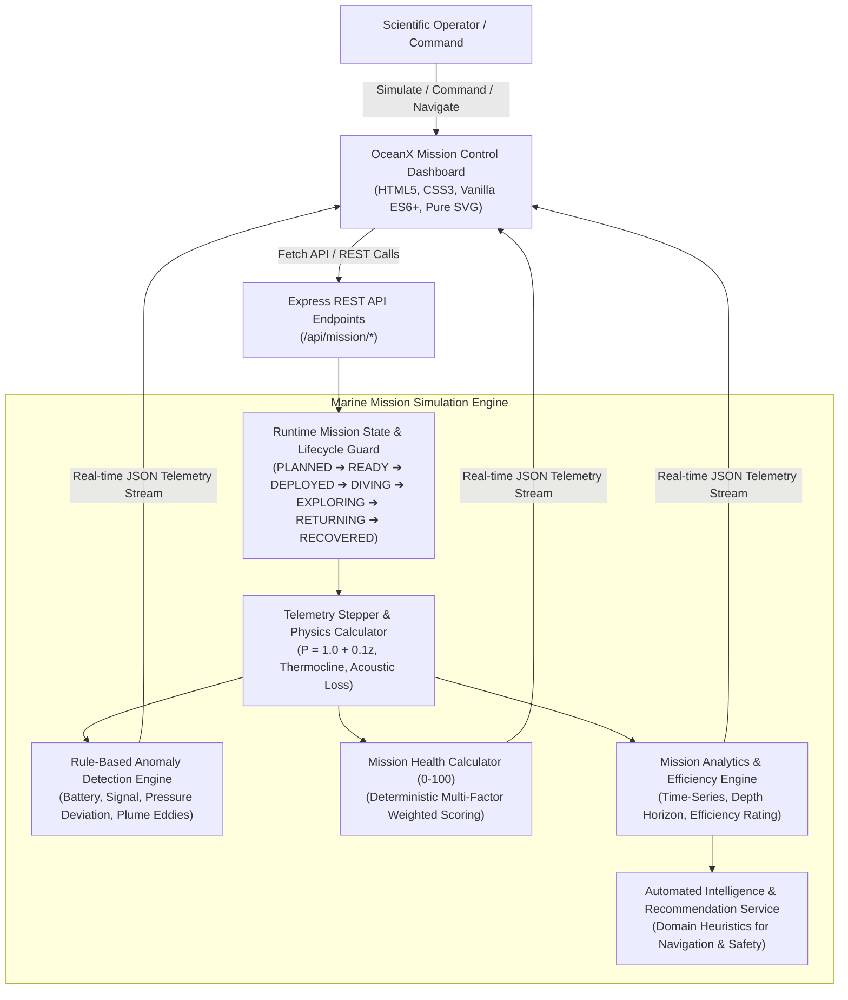
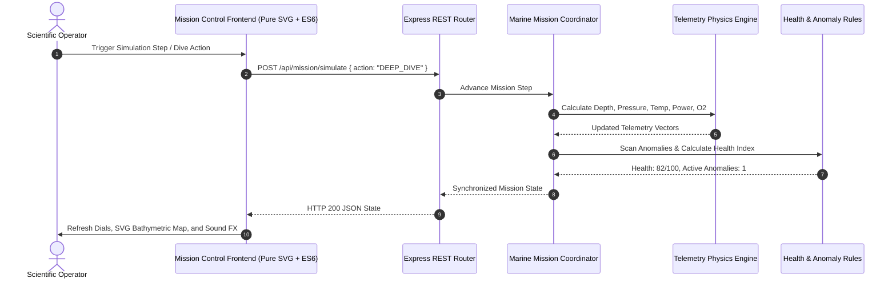
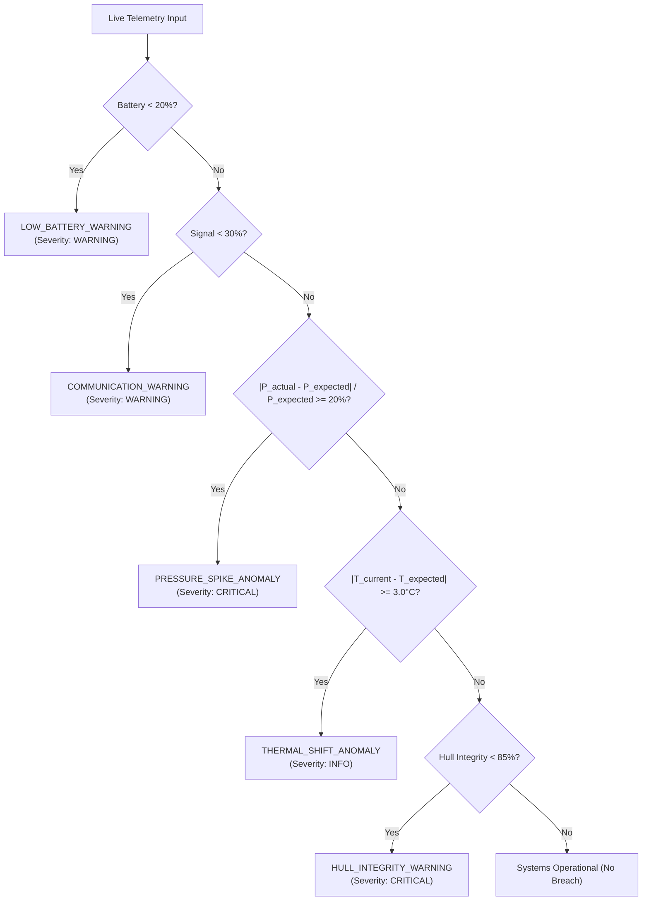

# 🌊 OceanX — Smart Ocean Exploration & Marine Mission Monitoring System

> **Explore. Monitor. Discover.**  
> *Autonomous Submersible Telemetry, Bathymetric Reconnaissance & Marine Science Mission Control*

---

## 🧭 Executive Overview

**OceanX** is an enterprise-grade deep-sea exploration and marine mission monitoring system. Designed as a real-time Mission Operations Center (MOC), OceanX simulates how oceanographic research teams plan, deploy, monitor, and recover autonomous underwater exploration vehicles (AUVs) and manned submersibles operating in extreme bathypelagic and abyssopelagic environments.

Instead of displaying static ocean data, OceanX is powered by a stateful **Marine Mission Engine** that calculates physical oceanographic properties in real time—hydrostatic pressure, thermal layers, acoustic signal attenuation, power drain, atmospheric scrubbers, and hull stress—while evaluating rule-based anomalies, scientific discoveries, and deterministic mission health.



---

## 📐 Main Technical Architecture

OceanX employs a decoupled, cloud-ready three-tier architecture:



### Truthful Cloud-Ready Architecture Statement
OceanX currently runs on high-performance in-memory JavaScript state objects with zero external database dependencies. This ensures that the application operates instantly out-of-the-box on any standard Node.js runtime without provisioning complex cloud clusters. The service boundary layer (`services/missionEngine.js`) is decoupled such that the in-memory state can be seamlessly replaced with persistent database storage (PostgreSQL, MongoDB, Redis) or cloud telemetry streaming engines (AWS IoT Core, Azure Event Hubs, GCP Pub/Sub) without altering client-facing API contracts.

---

## 🎛️ Core System Modules

| Icon | Module | Description | Route |
| :---: | :--- | :--- | :--- |
| 🛰️ | **Mission Control** | Master real-time command dashboard displaying live telemetry tiles, 3D card tilt physics, composite health dial, and interactive SVG bathymetric map. | `/` or `/index.html` |
| 🤿 | **Submersible** | Subsystem diagnostics (quad azimuth thrusters, titanium hull, double-circuit O2 scrubbers, acoustic hydrophones) and lifecycle controls. | `/submersible` |
| 🧭 | **Exploration** | Interactive high-resolution bathymetric depth chart (0 to 6,500m) with acoustic sonar wave sweeps, descent trajectory trails, and waypoint logs. | `/exploration` |
| 🐠 | **Discoveries** | Scientific specimen catalog tracking benthic fauna, hydrothermal vents, and geological formations with importance classifications (LOW to CRITICAL). | `/discoveries` |
| 🚨 | **Anomalies** | Continuous rule-based telemetry diagnostic center supporting operator acknowledgment, resolution lifecycles, and urgent alarms. | `/anomalies` |
| 📊 | **Analytics** | Pure SVG time-series profiles (Depth, Battery, Temperature, Pressure, Signal) and deterministic Mission Efficiency Score breakdowns. | `/analytics` |
| 📋 | **Timeline** | Chronological event stream tracking deployment milestones, descent horizons, specimen discoveries, and operator command dispatches. | `/timeline` |
| 🧪 | **Simulation** | Mission Simulation Center featuring all 9 environmental simulation actions and step advances. | `/simulation` |
| 📄 | **Mission Report** | Publication-grade executive expedition dossier with isolated A4 PDF export precision and browser print stylesheet. | `/reports` |

---

## 🌊 Physical Oceanography & Telemetry Formulas

OceanX computes ocean physical variables using deterministic hydrodynamic principles:

### 1. Hydrostatic Pressure Equation
Hydrostatic pressure increases linearly with depth according to the standard oceanic gradient ($1.0\text{ bar}$ per $10\text{ meters}$ of seawater):
$$P(z) = P_0 + 0.1 \times z$$
Where:
- $P(z)$ = Hydrostatic pressure in **bar**
- $P_0$ = Surface atmospheric pressure ($1.0\text{ bar}$)
- $z$ = Current depth in meters

*Example: At $4,280\text{ m}$, $P = 1.0 + 0.1 \times 4280 = 429.0\text{ bar}$.*

### 2. Oceanic Thermocline Temperature Model
Seawater temperature follows a realistic three-layer ocean stratification curve:
- **Epipelagic Layer ($0 - 200\text{m}$):** Rapid decline from surface warm waters ($24.0^\circ\text{C}$ to $14.0^\circ\text{C}$)
- **Mesopelagic Thermocline ($200 - 1,000\text{m}$):** Steep gradient transitioning from $14.0^\circ\text{C}$ down to $4.5^\circ\text{C}$
- **Deep Isotherm Layer ($> 1,000\text{m}$):** Asymptotic stabilization approaching the benthic minimum ($1.8^\circ\text{C} - 2.8^\circ\text{C}$):
$$T(z) = 2.0 + 2.5 \times \exp\left(-\frac{z - 1000}{1500}\right)$$

### 3. Acoustic Signal Attenuation
High-frequency acoustic communications attenuate through water columns due to geometric spreading and viscosity:
$$\text{Signal}(z) = \max\left(15, 100 - \frac{z}{55}\right)$$

---

## 🛡️ Mission Health Scoring Algorithm

Mission Health is computed via a transparent deterministic multi-factor formula ($0 - 100$ scale). **It is not an opaque or probabilistic AI model.**

### Factor Weights:
| Subsystem Factor | Weight | Evaluation Criteria |
| :--- | :---: | :--- |
| **Battery Reserves** | 25% | Direct percentage of remaining power storage |
| **Atmospheric Oxygen** | 20% | Life support scrubbed O2 concentration |
| **Hull Structural Integrity** | 20% | Titanium pressure hull stress indicator |
| **Acoustic Communications** | 15% | Uplink signal quality to surface vessel |
| **Hydrostatic Pressure Safety** | 10% | Proximity to submersible maximum crush rating |
| **Active Anomaly Index** | 10% | Deductions of $-15\text{ pts}$ per critical and $-5\text{ pts}$ per warning anomaly |

$$\text{Health Score} = 0.25B + 0.20O + 0.20H + 0.15C + 0.10P_{\text{safe}} + 0.10A_{\text{index}}$$

### Emergency Safety Ceiling Override:
If battery falls below $20\%$, oxygen falls below $25\%$, or hull integrity drops below $80\%$, the overall Mission Health Score is **strictly capped at $45$ (CRITICAL)** regardless of other parameters, enforcing operational safety realism.

---

## 🚨 Automated Rule-Based Anomaly Detection Matrix

The Anomaly Engine scans telemetry against operational safety bounds on every step:



---

## 📈 Mission Efficiency Score Formula

Mission Efficiency assesses operational pacing, depth attainment, and safety on a $0 - 100$ scale:
$$\text{Efficiency Score} = 0.30D_{\text{attain}} + 0.25A_{\text{cover}} + 0.20T_{\text{pace}} + 0.15P_{\text{disc}} + 0.10S_{\text{index}}$$

Where:
- $D_{\text{attain}}$ = $\min(100, (\text{Max Depth} / \text{Target Depth}) \times 100)$
- $A_{\text{cover}}$ = Area exploration completion percentage
- $T_{\text{pace}}$ = Execution duration adherence
- $P_{\text{disc}}$ = Discoveries per mission phase ($20\text{ pts}$ per cataloged discovery, capped at $100$)
- $S_{\text{index}}$ = Incident-free safety index ($100 - 10 \times \text{unresolved anomalies}$)

---

## 🧪 Simulation Center Actions

OceanX provides 9 deterministic mission simulation actions via `POST /api/mission/simulate`:

1. **`NORMAL_DIVE`**: Increases depth by $+250\text{m}$, updates hydrostatics, and advances exploration progress.
2. **`DEEP_DIVE`**: Rapid descent by $+600\text{m}$ into deeper bathymetric horizons.
3. **`LOW_BATTERY`**: Forces battery reserves down to $18\%$, immediately tripping the automated low battery warning.
4. **`COMM_LOSS`**: Degrades acoustic transceiver signal to $18\%$, simulating bathymetric shadow zones.
5. **`PRESSURE_SPIKE`**: Introduces an external $+28\%$ chamber pressure surge, triggering a critical anomaly.
6. **`TEMP_SHIFT`**: Simulates contact with an oceanic hydrothermal plume ($+4.5^\circ\text{C}$ thermal shift).
7. **`MARINE_DISCOVERY`**: Automatically detects and catalogs a novel abyssal marine species.
8. **`CRITICAL_ANOMALY`**: Simulates simultaneous sensor deviations, testing operator incident response.
9. **`EMERGENCY_RETURN`**: Triggers emergency ballast blow, switching status to `RETURNING` and initiating immediate ascent.

---

## 📡 REST API Reference

| Method | Endpoint | Description | Payload / Parameters |
| :--- | :--- | :--- | :--- |
| `GET` | `/api/health` | System health check and runtime metadata | None |
| `GET` | `/api/mission` | Full active mission overview and vehicle state | None |
| `POST` | `/api/mission` | Create and initialize a new expedition | `{ name, region, objective, targetDepth, plannedDurationMinutes }` |
| `PATCH` | `/api/mission/status` | Advance lifecycle status | `{ status: "READY" \| "DEPLOYED" \| "DIVING" \| "EXPLORING" \| ... }` |
| `GET` | `/api/mission/telemetry` | Real-time vehicle telemetry vectors | None |
| `POST` | `/api/mission/simulate` | Advance telemetry or execute simulation action | `{ action: "NORMAL_DIVE" \| "PRESSURE_SPIKE" \| ... }` |
| `GET` | `/api/mission/health` | Mission health score and factor breakdown | None |
| `GET` | `/api/mission/anomalies` | Query anomaly incident registry | Query params: `?status=ACTIVE&severity=CRITICAL` |
| `PATCH` | `/api/mission/anomalies/:id/acknowledge` | Acknowledge active anomaly incident | None |
| `PATCH` | `/api/mission/anomalies/:id/resolve` | Resolve and stabilize anomaly | None |
| `GET` | `/api/mission/discoveries` | Query scientific specimen catalog | Query params: `?type=Marine Species` |
| `POST` | `/api/mission/discoveries` | Catalog new scientific discovery | `{ name, type, depth, importance, description }` |
| `GET` | `/api/mission/timeline` | Retrieve chronological mission event stream | None |
| `GET` | `/api/mission/analytics` | Retrieve time-series profiles and efficiency score | None |
| `POST` | `/api/mission/emergency-return` | Initiate emergency abort and surface ascent | None |
| `GET` | `/api/mission/report` | Complete executive mission dossier | None |
| `POST` | `/api/mission/reset` | Revert active mission to PLANNED pre-launch state | None |
| `POST` | `/api/mission/sample` | Restore pristine sample expedition data | None |
| `DELETE`| `/api/mission` | Clear in-memory mission data | None |

---

## ⚡ Computational Complexity & Algorithmic Bounds

| Operation | Function / Routine | Time Complexity | Space Complexity | Rationale |
| :--- | :--- | :---: | :---: | :--- |
| Hydrostatic Pressure | `calculateHydrostaticPressure(depth)` | $\mathcal{O}(1)$ | $\mathcal{O}(1)$ | Direct constant-time arithmetic evaluation |
| Thermocline Model | `calculateExpectedTemperature(depth)` | $\mathcal{O}(1)$ | $\mathcal{O}(1)$ | Constant-time exponential decay evaluation |
| Mission Health Index | `calculateMissionHealth(sub, anomalies)` | $\mathcal{O}(a)$ | $\mathcal{O}(1)$ | Linear scan over active anomaly count $a$ |
| Anomaly Detection | `scanForAnomalies(sub, anomalies)` | $\mathcal{O}(r + a)$ | $\mathcal{O}(a)$ | Constant rules $r$ evaluated against anomaly registry $a$ |
| Telemetry Stepper | `advanceTelemetry(mission, deltaMinutes)` | $\mathcal{O}(h)$ | $\mathcal{O}(1)$ | Constant time physics update + historical buffer push |
| Analytics Generation | `generateMissionAnalytics(mission)` | $\mathcal{O}(n + d + a)$ | $\mathcal{O}(n)$ | Single pass over telemetry points $n$, discoveries $d$, anomalies $a$ |
| Discovery Catalog Search | `filterDiscoveries(type, importance)` | $\mathcal{O}(d)$ | $\mathcal{O}(d)$ | Linear filter over discovery entries $d$ |

---

## 🧪 Automated Testing & Verification Suite

OceanX includes comprehensive unit and integration test suites:

### 1. Core Unit Tests (`tests/test-suite.js`)
- Physics mathematics and thermocline boundary conditions
- Lifecycle transition state guards
- Deterministic health formula and emergency ceiling overrides
- Anomaly scanning and state lifecycle
- Analytics and efficiency breakdown

### 2. Comprehensive REST Integration Tests (`tests/comprehensive-test.js`)
- Positive and negative input validation
- HTTP status codes (200, 201, 400, 404)
- Live simulation stepping and parameter diffing
- Anomaly acknowledgment and resolution
- Emergency return execution
- Full executive report dossier payload verification

### Running the Test Suites:
```bash
# Run unit test suite
npm test

# Run all test suites (Unit + REST Integration)
npm run test:all
```

---

## 🚀 Getting Started

### Prerequisites
- Node.js (v18.0.0 or higher)
- npm (v9.0.0 or higher)

### Installation
```bash
# Navigate to project directory
cd C:\Users\rosha\oceanx

# Install dependencies
npm install
```

### Running the Application
```bash
# Start OceanX Mission Control Server
npm start
```

Access the Mission Control Dashboard at:
**`http://localhost:3001`**

---


